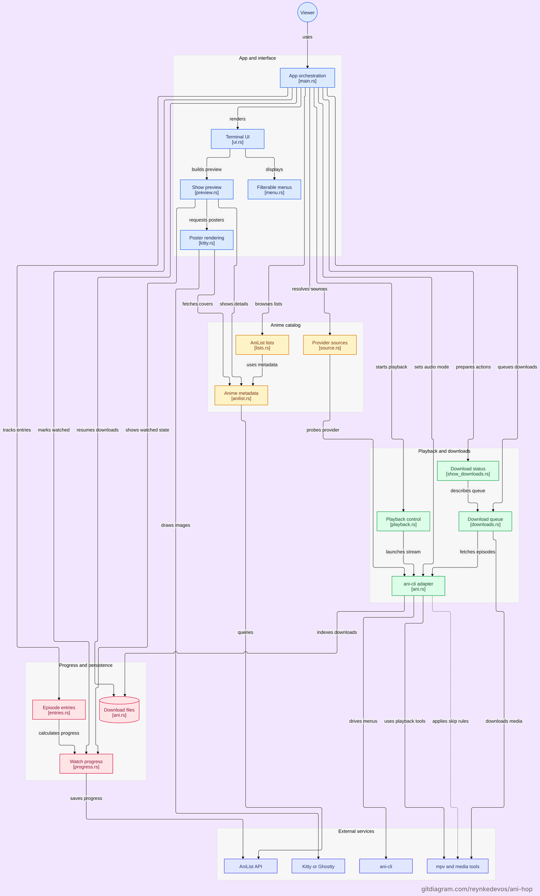

# ani-hop


A fast terminal UI for anime: find a show, then stream or download it through [ani-cli](https://github.com/pystardust/ani-cli).

| Feature | What it does |
| --- | --- |
| **No scraper of its own** | Every source comes from `ani-cli`, which a large community keeps working on. When a site changes, updating `ani-cli` is enough. One small exception: if `ani-cli` finds no subtitles for an episode, ani-hop gets English fallback subtitles itself. |
| **Posters in the terminal** | In Ghostty and kitty, even inside tmux/herdr, though slower there. |
| **AniList built in** | Your lists, with watched episodes marked. The main menu's first row plays your next episode. After each episode it asks to save your progress, and "Watched up to…" sets it for many episodes at once, or back to none. |
| **Jump to related seasons and shows** | A show's page lists its seasons in story order, then its movies, OVAs and side stories. |
| **Find an episode by what happens in it** | The filter searches the titles and summaries of watched episodes. Unwatched ones stay blank, so nothing spoils. |
| **Downloads in the background** | Pause them or quit; unfinished ones come back after a restart. |
| **Sub or dub** | Japanese or English audio, with or without subtitles, for all shows or just one. |
| **Skips openings and endings** | In streams and downloads alike. A show's last episode keeps its ending, as the story can go on after it. |

## Install

### Debian/Ubuntu, Fedora, Arch and their derivatives

```sh
curl -fsSL https://raw.githubusercontent.com/ReynkeDeVos/ani-hop/main/install.sh | sh
```

Installs ani-hop, ani-cli, mpv and the rest. Run it again to update ani-hop; ani-hop tells you when there's a new version. If you already have ani-cli, the script leaves it alone.

### mise

```sh
mise use -g github:ReynkeDeVos/ani-hop
```

For Linux (x86-64 or ARM) and Apple silicon Macs. Installs only ani-hop. It checks for ani-cli, mpv and the rest at the start and offers to install what's missing.

### macOS (Apple silicon)

```sh
brew tap pystardust/ani-cli https://github.com/pystardust/ani-cli.git
brew install pystardust/ani-cli/ani-cli reynkedevos/tap/ani-hop
```

Update with `brew upgrade`.

### Windows

ani-hop runs in WSL. In PowerShell as admin:

```powershell
wsl --install -d Ubuntu-26.04
```

Restart, open Ubuntu and run the `curl` line above. For posters, run ani-hop in Ghostty: `sudo apt install -y ghostty`.

<details>
<summary>Other distros, Nix, or from source</summary>

On other distros the script installs ani-hop and ani-cli, then lists the system packages to install yourself.

With Nix, on NixOS or another Linux:

```sh
nix profile add github:ReynkeDeVos/ani-hop
```

Brings its own ani-cli, mpv and the rest. Update with `nix profile upgrade ani-hop`; `nix run github:ReynkeDeVos/ani-hop` tries it without installing. Both need flakes switched on.

On NixOS or with Home Manager, add it to your flake instead:

```nix
inputs.ani-hop.url = "github:ReynkeDeVos/ani-hop";
# in a module (Home Manager: home.packages)
environment.systemPackages = [ inputs.ani-hop.packages.${pkgs.stdenv.hostPlatform.system}.default ];
```

Update with `nix flake update ani-hop` and a rebuild. Leave out `inputs.nixpkgs.follows` unless your nixpkgs is unstable: ani-hop needs ani-cli 5.1, and NixOS 26.05 has 5.0.

From source: `cargo install --locked --git https://github.com/ReynkeDeVos/ani-hop` (Rust 1.89 or newer). It needs [ani-cli](https://github.com/pystardust/ani-cli) 5.1 or newer, [mpv](https://mpv.io), [yt-dlp](https://github.com/yt-dlp/yt-dlp), ffmpeg, curl, patch and xdg-utils. ani-hop checks for them at the start and offers to install what's missing.

</details>

## License

[GPL-3.0-or-later](LICENSE)

## Inspiration and alternatives

ani-hop was inspired by [viu](https://github.com/viu-media/viu) (formerly FastAnime) and how its interface is structured. Sadly, it isn't being developed anymore.

Looking for alternatives? These are all worth a look:

- [GoAnime](https://github.com/alvarorichard/GoAnime): anime, movies and TV shows from several sources at once, in English and Brazilian Portuguese.
- [weeb-cli](https://github.com/ewgsta/weeb-cli): sources in four languages, with AniList, MyAnimeList and Kitsu sync.
- [mal-tui](https://github.com/swstl/mal-tui): a great home for MyAnimeList users.
- [anitrack](https://github.com/MiguelRegueiro/anitrack-cli): a simple companion that remembers where you stopped in `ani-cli`.
- [ani-gui](https://github.com/JoaoPucci/ani-gui): a full desktop app with a built-in player and watch parties.

Like mal-tui and anitrack, ani-hop leaves finding streams to `ani-cli`, so when a site changes, updating `ani-cli` is enough. One thing I haven't found in any of them: searching episodes by what happens in them.

<sub>Curious how the code is structured? Here is the architecture diagram:</sub>

<a href="architecture.png"></a>
